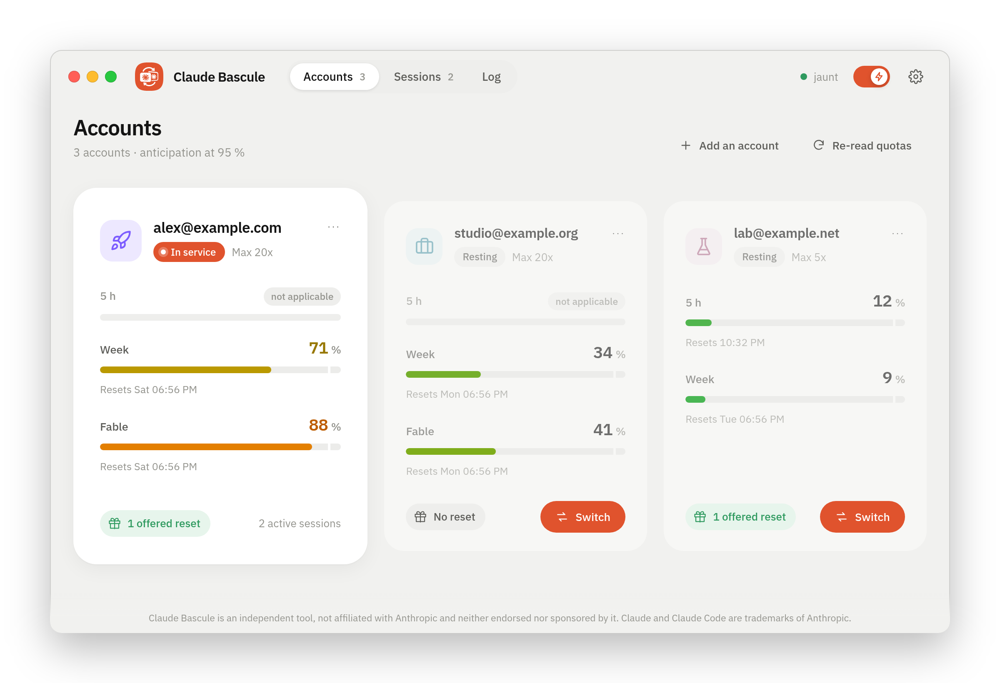

<p align="center">
  <picture>
    <source media="(prefers-color-scheme: dark)" srcset="assets/header-dark.png">
    
  </picture>
</p>

<p align="center">
  <b>Claude Bascule is an independent, free and open-source tool. It is not made by Anthropic,<br>
  not affiliated with Anthropic, and not endorsed or sponsored by Anthropic.</b><br>
  <sub>Claude and Claude Code are trademarks of Anthropic.</sub>
</p>

<p align="center">
  <picture>
    <source media="(prefers-color-scheme: dark)" srcset="assets/screenshot-dark.png">
    
  </picture>
</p>

If you use several Claude accounts with Claude Code, Claude Bascule moves Claude Code to another
account **before** you hit a usage limit, and offers to resume the work a limit interrupted.

- **Automatic switch**: when the account in use nears a limit (95 % by default), Claude Code moves
  to the account with the most room left. Your running sessions follow at their next message.
- **All your quotas at a glance**: 5-hour, weekly and per-model limits of every account, and the
  resets Anthropic offers you.
- **Switch by hand** whenever you like, in one click.
- **Resume interrupted sessions** with a message of your choice (needs [jaunt](https://jaunt.one)).
- **Everything adjustable**: thresholds, delays, the order of accounts, notifications, theme,
  language (English, French, German, Spanish, Italian, Portuguese).
- **Updates itself**: when a new version is out, the app offers it.

Your sign-in tokens stay on your computer. Claude Bascule only talks to Anthropic to read quotas,
as Claude Code does.

## Install

You need [Claude Code](https://docs.anthropic.com/claude-code) installed.

**macOS and Linux**: open a terminal and run

```sh
curl -fsSL https://github.com/moukrea/ClaudeBascule/releases/latest/download/install.sh | sh
```

**Windows**: open PowerShell and run

```powershell
irm https://github.com/moukrea/ClaudeBascule/releases/latest/download/install.ps1 | iex
```

The same command updates Claude Bascule. It installs for your user only (no administrator rights)
and starts with your session.

> Linux: x86_64, with WebKitGTK 4.1 (present on most desktops; the installer tells you if it is missing).
> macOS: the app is not notarised by Apple; installing with the command above avoids the warning.

## First steps

1. Open **Claude Bascule**. The account Claude Code is signed in with is already there.
2. Click **Add an account** and sign in to each of your other Claude accounts in your browser.
3. That's it: automatic switching is on (the lightning toggle at the top).

## With or without jaunt

Claude Bascule works on its own: it reads every account's quotas from Anthropic (the account in
use every 5 minutes) and switches before the threshold.

With [jaunt](https://jaunt.one) installed, it also sees your Claude Code sessions live, which adds:

- a switch the moment a session hits a limit, instead of at the next quota read;
- fresher numbers for the account in use between two reads;
- per-model limits (a model's weekly limit) counted only for models your sessions are using;
- resuming the sessions a limit interrupted.

The jaunt dot at the top of the window shows the connection: green when connected; click it to
connect when jaunt is installed but not connected yet.

## claude.ai in your browser (optional)

Claude Bascule can switch claude.ai in Chrome, Edge, Brave or Chromium along with Claude Code,
or on its own from an account's menu. It needs its small companion extension,
**Claude Bascule Connector**, installed once:

1. Open **Settings → Browser** in Claude Bascule: it shows the extension's folder.
2. In the browser, open `chrome://extensions`, turn on **Developer mode**, click
   **Load unpacked** and choose that folder.
3. Sign each account in to claude.ai once in that browser (the button **Sign in in the browser**
   opens the page). Claude Bascule keeps each session in its private folder, like the tokens.

The Claude in Chrome extension keeps its own sign-in: it follows the browser's account the next
time it signs in; sign out and in again from its panel to make it follow at once (no code needed).

## Back up your accounts

**Settings → Accounts → Export all accounts** (or **Export this account** in an account's menu)
saves a JSON file in your Downloads folder: each account with its name, icon, place in the
rotation, claude.ai session and Claude Code sign-in. **Import a backup** (same place, or in
**Add an account**) adds the accounts that are missing and never overwrites what is already here.

The file holds those accounts' sign-ins: keep it like a password. Claude Code renews its sign-in
every few hours and each renewal retires the previous one, so the sign-in in a backup comes back
on the same computer as long as it was not renewed since the export (for example, an account
deleted right after). Another computer never takes it over, since that would sign this one out:
sign the account in there once. From a terminal: `bascule export` and `bascule import <file>`.

## Uninstall

- **Linux**: `systemctl --user disable --now claude-bascule; rm -f ~/.local/bin/bascule ~/.local/bin/bascule-app ~/.config/systemd/user/claude-bascule.service ~/.local/share/applications/claude-bascule.desktop`
- **macOS**: `launchctl bootout gui/$(id -u)/io.github.moukrea.claudebascule; rm -rf ~/Applications/Claude\ Bascule.app ~/Library/LaunchAgents/io.github.moukrea.claudebascule.plist ~/.local/bin/bascule`
- **Windows**: close the app, then in PowerShell `Remove-ItemProperty HKCU:\Software\Microsoft\Windows\CurrentVersion\Run ClaudeBascule; Remove-Item -Recurse "$env:LOCALAPPDATA\Programs\ClaudeBascule", "$([Environment]::GetFolderPath('Programs'))\Claude Bascule.lnk"`

Your settings and the saved accounts stay in a private folder ([docs/internals.md](docs/internals.md#folders))
until you delete it.

## Questions

- **Is it allowed?** Claude Bascule switches between accounts that are yours; check that your use
  of several accounts follows [Anthropic's terms](https://www.anthropic.com/legal).
- **Something is wrong?** [Open an issue](https://github.com/moukrea/ClaudeBascule/issues).
- **Want to help?** See [CONTRIBUTING.md](CONTRIBUTING.md).

MIT licence. Account icons from [Lucide](https://lucide.dev) (ISC licence).
